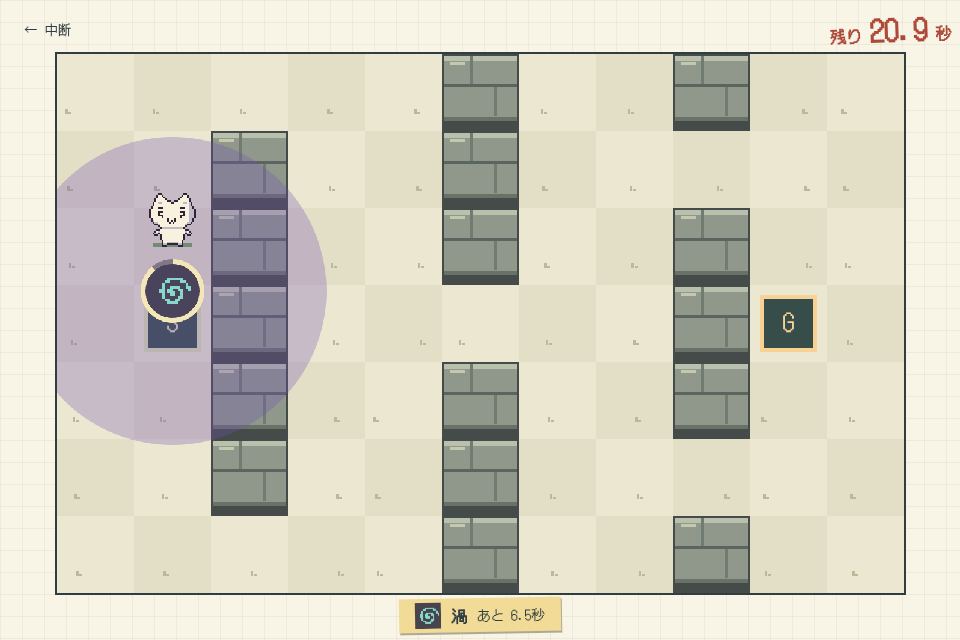

## 内容

ゴールへ向かうNPCを、能力を使って妨害するブラウザゲームです。
まずは1ステージ・1 NPC・1種類の能力で遊べる状態を目指します。

[ブラウザで遊ぶ（β版）](https://ring128.github.io/webgame-no-named/)

β版はブラウザ内で動作します。能力の解放とスキンはこのブラウザに保存され、プレイ内容やスコアがゲームサーバーに送信されることはありません。

## 技術構成

### フロントエンド

- TypeScript（操作入力とHTTPポーリングによるゲーム状態の取得）
- Vite（開発サーバーと本番ビルド）
- HTML・CSS（メニューと全画面プレイのレイアウト）
- Canvas API（マップ・NPC・能力アイコンのドット絵描画）

### バックエンド

- C++20（A*による経路探索、NPCの移動、制限時間・勝敗・スコアの判定）
- CMake（ビルド用）、CTest（ゲームとランキングのテスト用）
- Drogon（フロントエンドの配信とHTTP API）
- OpenID Connect（ランキング用のGoogleログイン）
- JSON（進捗・スキン・ランキングの保存）、SQLite（意見と投稿者ブロックの保存）

### 今後導入を検討

- PostgreSQL：ユーザー情報・挑戦記録・ランキングの保存
- WebSocket：協力プレイ時の状態同期

## 現在の進捗

- [x] ゲームの基本ルールと実装手順を整理
- [x] TypeScript・CanvasとC++・Drogonで開発環境を構築
- [x] NPCの経路探索と、能力で進路を妨害できるステージを実装
- [x] ブラウザでクリア・敗北・再挑戦を確認
- [ ] 実際に遊びながら動作を見直し、コードを整理する
- [x] GitHub Pagesでプレイできるβ版を公開